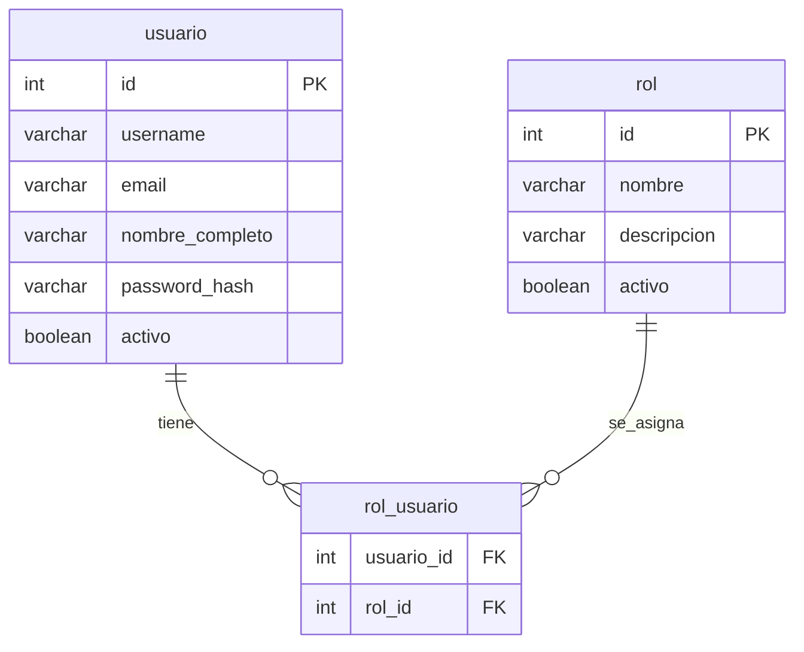

# 5_data_model.md — Modelo de datos, versión 3

**Motor:** MariaDB · **BD local:** `investigacion` · **En Alwaysdata:** usar nombre de BD suministrado en su panel, sin asumir que es idéntico.  
**Herencia:** 16 tablas académicas V1/V2 + 3 tablas de gestión de usuarios = **19 tablas** del proyecto.

> Los campos de V3 reflejan la estructura usada en el desarrollo. Antes de desplegar, contrastar con `SHOW CREATE TABLE` del esquema exportado: no se debe inventar una migración sobre una base diferente.

## 1. Entidades nuevas / habilitadas en V3

### `usuario`

| Columna | Tipo funcional | Restricción / uso |
|---|---|---|
| `id` | entero | PK, identificador del usuario |
| `username` | texto | obligatorio, índice UNIQUE; login |
| `email` | texto | obligatorio, índice UNIQUE |
| `nombre_completo` | texto | obligatorio |
| `password_hash` | texto | hash generado por `password_hash()`; jamás mostrarlo |
| `activo` | booleano/tinyint | 1 activo, 0 desactivado |

La longitud exacta y AUTO_INCREMENT deben leerse del DDL real. El servicio actualmente valida `username` de 3–50 caracteres ASCII admitidos, correo hasta 150 bytes y nombre de 2–120 bytes.

### `rol`

| Columna | Tipo funcional | Uso |
|---|---|---|
| `id` | entero | PK |
| `nombre` | texto | identificador del rol: `admin` o `consulta` |
| `descripcion` | texto | descripción opcional según DDL |
| `activo` | booleano/tinyint | 1 permite usar el rol |

**Restricción recomendada:** unicidad de `nombre`; verificar en la base real.

### `rol_usuario`

| Columna | Uso |
|---|---|
| `usuario_id` | FK lógica/física a `usuario.id` |
| `rol_id` | FK lógica/física a `rol.id` |

El par `(usuario_id, rol_id)` debe ser único para evitar asignaciones duplicadas. Verificar que el DDL realmente tenga FKs y PK/índice compuesto.

## 2. Relaciones



## 3. Relaciones académicas existentes

Las seis tablas de catálogo: `area_conocimiento`, `objetivo_desarrollo_sostenible`, `area_aplicacion`, `termino_clave`, `universidad`, `linea_investigacion`.

Las diez restantes: `docente`, `grupo_investigacion`, `semillero`, `participa_grupo`, `participa_semillero`, `grupo_linea`, `semillero_linea`, `ac_linea`, `ods_linea`, `aa_linea`.

- `grupo_investigacion → semillero` es maestro-detalle y usa procedimientos almacenados de V2.
- `semillero` se consulta por separado, pero su creación/retiro se gestiona mediante el grupo.
- Las siete tablas puente tienen operaciones de asignación/retiro según contratos V2.
- V3 agrega control de acceso: **no altera su significado ni sus llaves foráneas**.

## 4. Reglas de integridad

1. **Usuario único:** `username` y `email` deben disponer de índices `UNIQUE` independientes; la comprobación de la aplicación no sustituye a la base.
2. **Registro atómico:** `INSERT usuario` y `INSERT rol_usuario` bajo una misma transacción; `ROLLBACK` ante error.
3. **Rol inicial:** `consulta` activo, asignado en la creación. No se aceptan roles arbitrarios desde el cuerpo del POST.
4. **Login:** `usuario.activo=1` y al menos un rol activo para autorizar.
5. **Revocación:** si se desactiva `rol`, se quita `rol_usuario` o se desactiva `usuario`, debe revocarse acceso en la petición siguiente.
6. **Último administrador:** antes de quitar admin/desactivar cuenta admin, verificar transaccionalmente que sigue existiendo al menos uno. **Pendiente de implementar y probar.**
7. **Contraseñas:** guardar solo `password_hash` y no devolver nunca esa columna desde las lecturas de API.

## 5. Consultas de diagnóstico (solo lectura)

```sql
-- Seleccionar primero la BD local correcta en phpMyAdmin.
SELECT TABLE_NAME
FROM information_schema.TABLES
WHERE TABLE_SCHEMA = DATABASE()
  AND TABLE_TYPE = 'BASE TABLE'
ORDER BY TABLE_NAME;

-- Ver la estructura real de las tres tablas:
SHOW CREATE TABLE usuario;
SHOW CREATE TABLE rol;
SHOW CREATE TABLE rol_usuario;

-- Verificar indices UNIQUE de username y email:
SELECT INDEX_NAME, NON_UNIQUE,
       GROUP_CONCAT(COLUMN_NAME ORDER BY SEQ_IN_INDEX) AS columnas
FROM information_schema.STATISTICS
WHERE TABLE_SCHEMA = DATABASE()
  AND TABLE_NAME = 'usuario'
GROUP BY INDEX_NAME, NON_UNIQUE;
```

**Atención:** no pegar SQL con datos personales en GitHub; para pruebas usar identificadores ficticios. La exportación completa de MariaDB contiene usuarios y hashes, por lo que debe tratarse como material privado.

## 6. Migración / despliegue a Alwaysdata

- Crear BD vacía y usuario de BD con privilegios necesarios.
- Seleccionar la BD destino en phpMyAdmin **antes** de importar; se observó error `#1046 No database selected` cuando no se hizo.
- Revisar `CREATE DEFINER` de procedimientos V2: el definidor local `investigacion@%` puede ser inválido en Alwaysdata.
- No ejecutar el dump dos veces si hubo importación parcial. Validar conteo, roles, usuarios y `CALL` de procedimientos tras importar.
- Configurar secretos nuevos y no publicar volcado en el webroot.
